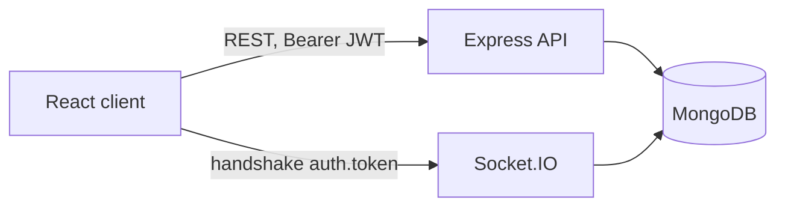

# ChatNest

ChatNest is a team chat app. People register, join channels, and keep direct messages. History lives in MongoDB. Anything that should feel instant — a new message, a typing indicator, someone coming online — goes through Socket.IO.

The browser keeps one socket for the signed-in user. That socket is authenticated with the same JWT the REST API uses, and it joins a room for each channel and direct message the person belongs to.

## Features

- Accounts with hashed passwords and JWT access for both HTTP and the socket handshake
- Channels, including a `#general` room every new account joins, plus direct messages between two people
- Live messages, typing indicators, and online presence (a person stays online until their last tab closes)
- Message history with cursor pagination, so the thread can scroll upward without skipping or repeating rows when new messages arrive at the bottom
- Docker Compose for the client, the API, and MongoDB

## Architecture



A channel room is named `channel:<id>`, a direct message is `conversation:<id>`, and each user also sits in `user:<id>` so the server can add their open tabs to a room they just joined.

Sending a message is a socket event, not a POST. The server checks membership, writes the document, and emits `message:new` to the room. The REST API is for history, the directory, and creating channels or conversations.

The client hook `useSocket` owns the connection. It connects when a token is present, sends that token in the handshake, and disconnects on logout or unmount. The composer stays disabled until the server has joined the user's rooms and pushed a presence snapshot, so the first keystroke is not racing the handshake.

## Project layout

```
├── docker-compose.yml
├── .env.example
├── client/                 React app (Vite)
│   ├── src/hooks/useSocket.js
│   ├── src/hooks/useChatRoom.js
│   ├── src/components/     sidebar, thread, composer
│   └── nginx.conf          proxies /api and /socket.io in Docker
└── server/
    ├── src/routes/         auth, channels, conversations, users
    ├── src/services/       membership checks and cursor queries
    ├── src/sockets/        handshake, rooms, typing, presence
    └── tests/              Jest: auth, pagination, sockets
```

## Running it locally

Install dependencies once:

```bash
npm install --prefix server
npm install --prefix client
```

Start MongoDB, then the API and the client. With Docker available, Mongo is the one container you need for day-to-day work:

```bash
docker compose up mongo -d
cp .env.example .env
npm run dev:server
npm run dev:client
```

The API listens on [http://localhost:4000](http://localhost:4000). The Vite app is on [http://localhost:5173](http://localhost:5173) and proxies `/api` and `/socket.io` to the API, so the browser talks to a single origin.

Register two users in two browsers, or seed a pair of accounts:

```bash
npm run seed
```

That creates `alice@chatnest.dev` and `bob@chatnest.dev`, both with password `password123`, plus `#general`, `#design`, and one direct message.

### Full stack in Docker

```bash
docker compose up --build
```

Open [http://localhost:3000](http://localhost:3000). nginx serves the built client and proxies the API and the websocket to the `api` service. Compose uses `JWT_SECRET` from `.env` when that file exists, and a local default otherwise. Change the secret before you point this at anything but your own machine.

Seed the Compose database with:

```bash
docker compose run --rm api node src/seed.js
```

## Tests

```bash
npm test
npm run lint
npm run build
```

`npm test` runs the API suite and the React suite.

The API tests use Jest and an in-memory MongoDB. They cover register, login, and `GET /api/auth/me` (including rejected tokens and duplicate accounts), cursor pagination for channels and direct messages, and the socket handshake. A socket without a valid JWT never connects. The same suite checks presence, typing, and that a message is stored and delivered only to members of the room.

The client tests use Jest and React Testing Library. They sign in, reject a short password on the register form, scroll a thread to ask for an older page, and check that `useSocket` connects with the token and disconnects when it unmounts.

`npm run build` produces the static client. `docker compose config` checks the Compose file, and `docker build` in `server/` and `client/` checks the images.

## Design decisions

**Cursor, not offset.** Each page is "messages older than this `(createdAt, _id)` pair". A message that arrives while you are reading does not shift the next page, and two messages in the same millisecond still have a stable order because `_id` breaks the tie. The thread keeps the scroll height when older rows are prepended, so the viewport does not jump.

**One JWT, two transports.** Login returns a token. REST calls send it as `Authorization: Bearer`. The socket sends it on `handshake.auth.token` (an `Authorization` header is accepted too). The handshake middleware loads the user before the connection is accepted, so a bad or expired token, or a token for a deleted account, fails with `connect_error` and never joins a room.

**Presence is a set of socket ids.** Multiple tabs share one user. The user is announced online on the first connection and offline when the set is empty. Typing is not stored. The server relays `typing:start` and `typing:stop` to everyone else in the room, and only if that socket has actually joined the room.

**The token sits in localStorage.** That keeps the demo easy to trace: refresh the page and `GET /api/auth/me` restores the session. Logout deletes the token on the client; the server does not keep a revocation list. A production version of this would use an httpOnly cookie and a way to revoke tokens. Passwords are hashed with bcrypt and never returned from the API.

**Same origin in every environment.** Vite proxies the API during development. In Docker, nginx does the same job and upgrades `/socket.io/` for websockets. The React code always calls relative URLs.
